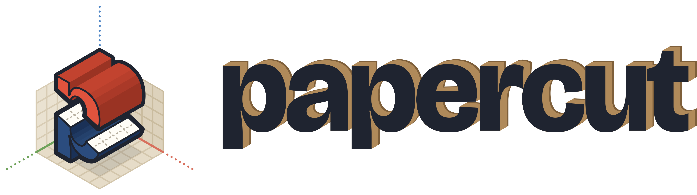

<p align="center">
  <picture>
    <source media="(prefers-color-scheme: dark)" srcset="brand/papercut-lockup-horizontal-dark.png">
    
  </picture>
</p>

# Level editor — prototype

An exploratory prototype for the editor described in
[`level-editor-design-brief.md`](level-editor-design-brief.md): a desktop editor
for building 3D levels in a Paper Mario / HD-2D style, where the artist never
models anything in 3D.

This is the first prototype slice, built to answer questions rather than to be
kept. See [`FINDINGS.md`](FINDINGS.md) for what it measured, [`CONTEXT.md`](CONTEXT.md)
for the vocabulary, and [`docs/decision-log.md`](docs/decision-log.md) for the
decisions and their reasoning.

**Try it in the browser:** <https://syynth.github.io/papercut/> — rebuilt
from `main` on every push by `.github/workflows/pages.yml`.

```bash
pnpm install
pnpm browsers      # once, fetch the Chromium build these scripts drive
pnpm dev           # http://localhost:5173
pnpm test          # unit tests
pnpm lint          # type-aware ESLint; no inline suppressions exist
pnpm bench         # mesher throughput
pnpm shoot         # drive it headless and save screenshots to shots/
pnpm tour          # capture the 25-step guided walkthrough to shots/tour/
pnpm probe         # measure whether post-processing survives on this GPU
pnpm perf          # frame time, memory, allocations and leaks per task, on this GPU (shots/perf/)
pnpm bake          # re-render packages/fixtures/baked/ (the sample map's placeholder art as PNG)
```

`shoot`, `tour` and `probe` default to a SwiftShader software renderer, for
parity with CI; add `--gpu` (e.g. `pnpm tour --gpu`) to drive the real GPU
backend instead. `bake` always uses the software renderer so two machines
produce byte-identical PNGs; it drives the editor's dev-only `/bake.html` in a
headless browser because the placeholder generator draws with a 2D canvas and
the repo has ruled against giving Node one. Run it whenever the sample map's
materials or texel density, or a sprite's footprint, change — two tests
(`tests/baked-fixtures.test.ts`, `packages/fixtures/src/baked.test.ts`) fail
until you do. The bake feeds the headless `apps/export-cli` (#48): it reads
the PNGs with a pure-JS decoder (`fast-png`) and hands the pixels to
`exportGltf` as `RgbaImage`s, since the runtime itself never touches a canvas.

```bash
pnpm --filter @papercut/export-cli build
node apps/export-cli/dist/cli.js in.json out.glb [--merge]
```

## What works

- **Terrain sculpt** — raise, lower, smooth and flatten by a strength or to a
  height, ramps cut from a cliff face by dragging. Brush, rectangle and flood-fill
  strokes, any brush size, square or round. Water pools per cell until the Water
  tool lands.
- **Terrain paint** — one material brush over a dual grid: the tile at every
  corner follows from the four cells around it, on tops and on cliff bands alike,
  from terrain sets the artist authors as transition tiles; per-cell tint; and a
  count of the transitions still to draw.
- **Image objects** — six display modes including the extruded paper-cutout
  slab, one to eight facings, mirroring, and the Paper Mario flip with
  hysteresis and a configurable hinge.
- **Camera rig** — yaw, pitch and zoom bounds, detent snapping, a sweep preview,
  free orbit that tints the viewport when it leaves the game's envelope, and a
  coverage readout that prices camera rotation in images the artist would have
  to draw.
- **Atmosphere** — presets that move fog, sky, lighting and post-processing
  together, plus painted backdrop cards for distant scenery.
- **Play mode** — walk the map with WASD, using the same runtime code the
  viewport renders through.
- **Save and load** — versioned JSON, with migrations and validation.
- **glTF export** — `.glb` with everything glTF cannot express in `extras`,
  documented in [`docs/extras-spec.md`](docs/extras-spec.md). Also available
  headlessly via `apps/export-cli` (#48), against the checked-in bake instead
  of a canvas.

## Keys

| | |
|---|---|
| `1` `2` `3` | Terrain, Objects, Camera |
| `Tab` | Sculpt / Paint |
| `[` `]` | Brush size |
| `Shift` | Erase, or invert (lower instead of raise) |
| `Alt` click | Eyedropper |
| `Ctrl` | Reach through objects to the terrain |
| `Ctrl+Z` / `Ctrl+Shift+Z` | Undo / redo |
| `G` | Clamp to the game's camera bounds |
| `P` | Play mode |
| `Delete` | Remove the selected object |
| `Alt` drag / middle drag | Orbit |
| Right drag | Pan |
| Scroll / pinch | Zoom |

## Layout

A pnpm workspace, orchestrated by Turborepo.

```
packages/registry/      command, tool, panel and keymap declarations; the availability DSL  — no deps at all
packages/document/      document, the document actor, undo, ops, paint  — xstate; no three.js, no React
packages/geometry/      meshers, terrain sets and the runtime atlas — no three.js, no React
packages/runtime/       the reference runtime: scene, billboards, camera, export
packages/viewport/      the imperative GL shell the editor drives
packages/editor-host/   the root actor, dispatch, the tools, view, gesture and play actors, React glue  — xstate, React
packages/feature-terrain/ the terrain tools as a feature module: commands, panels, the stroke contract
packages/ui/            the editor's design vocabulary (Mantine primitives)
packages/fixtures/      generated sample documents
packages/eslint-rules/  custom lint rules the workspace's own eslint.config.js plugs in
apps/editor/            React panels, tools and the app shell
```

The import direction `registry <- document <- geometry <- runtime <- viewport <- editor-host`
is enforced by two mechanisms rather than by a lint script.
`editor` — and any `apps/*` package — sits outside this ladder; apps may depend
on any rung. pnpm's strict
`node_modules` means a package can only import what its own `package.json`
declares — with one hole: a name the ROOT `package.json` declares hoists into
the root `node_modules`, so a package that never declared it can still resolve
it via Node's parent-directory walk. Outside that hole, `packages/document`
cannot reach three.js or React at all — the import fails to resolve. So pnpm
covers *undeclared* imports short of the root hoist, and nothing else: a wrong
entry in a `package.json` resolves perfectly well, and a declared entry point
that is itself a wildcard reopens a deep import past it. The direction itself,
plus those two edges, are asserted by `tests/dependency-direction.test.ts`,
which reads every workspace `package.json`, checks each declared arrow against
the ladder, checks the graph is acyclic, keeps runtime libraries (and their
`@types/` twins) off the root, and keeps every package's `exports` map
explicit. A package with no place on that ladder fails the test, so a new one
cannot be added unchecked. The runtime is the package a game would
consume; the editor renders through it, so the preview and the game cannot drift
apart.

`packages/ui` sits off the ladder at `document`'s rung — it may depend only on
`registry`, and is visible only to apps (currently `editor`), the
`editor-host` package, and feature packages (#49). A feature can't reach the
host because `editor-host` is absent from the feature allow-list; the host
can't reach a feature because the direction test's layer/side check refuses
any target that isn't itself a layer or a side, and `feature` is neither —
two separate mechanisms, not a shared rank. This property is asserted by the
dependency direction test with a `visibleTo` allowlist.

## Two things worth knowing before reading the code

**Paint is addressed in stable grid coordinates.** A face override is keyed by
cell, *layer* and side — never by mesh face, and never by a row index into a
swept profile — and holds a material, never a tile. Sculpt operations never
write to the paint layers, which is the entire mechanism behind painted work
surviving geometry edits. `packages/document/src/paint.ts` explains it properly,
and there is a test that lowers a cliff and raises it back.

**Assets are generated, not vendored.** The placeholder terrain set — a sheet
and the sidecar that tags what every tile on it is — and the sprites are drawn
procedurally at runtime, so nothing in this repository carries a licence. Load a
real sheet together with its sidecar from the Terrain set section; the editor
checks the sheet against the sidecar and says so when the tile size does not
match the map's texel density. `docs/terrain-spec.md` describes the whole
system.
